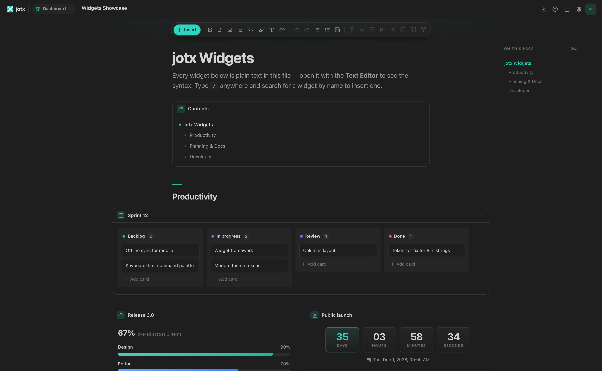
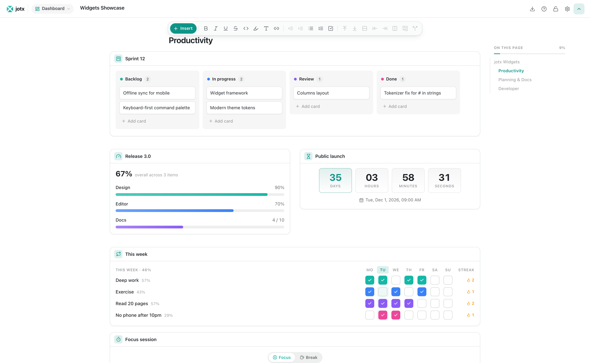
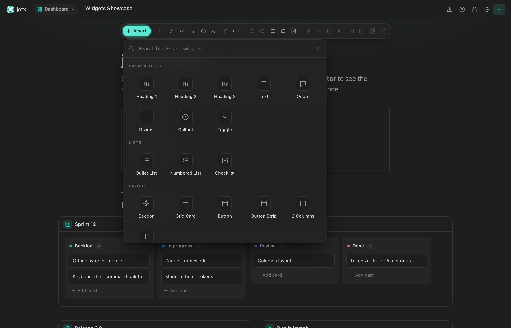

# jotx 3.1

**Notes that live in your repo — and read like a beautifully designed web page.**

jotx is a block editor for VS Code. Write with `/` commands, drop in live widgets like Kanban boards, timelines and diffs, and keep everything as clean, diff-friendly text files next to your code.



---

## What's new in 3.1

- **Compact syntax.** The same notes in about 40% fewer tokens, so AI assistants write, read and edit them for less. `def heading "Goals"` instead of three lines; list items, table rows and chart data one per line. jotx reads both syntaxes and converts either way: **jotx: Convert Workspace Syntax…** or `jotx migrate notes/ --to compact`.
- **Animated flow widget.** Show how a request, a save or a process moves through a system, step by step.
- **Properties is retired.** Use a table; existing properties blocks open as one.

## What's new in 3.0

- **A page, not a form.** Notes open like a modern docs site: a reading column for prose, full-width figures for tables, diagrams and widgets, a hero opening, and an *On this page* rail that tracks where you are.
- **19 new widgets.** Kanban, habit tracker, progress, countdown, focus timer, rating, priority matrix, pros & cons, decision records, table of contents, steps, timeline, terminal, API endpoint, file tree, diff, color palette, badges and keyboard shortcuts — plus 2- and 3-column layouts.
- **Insert gallery.** A floating toolbar with a searchable gallery of every block and widget. The `/` menu is grouped and ranks results as you type.
- **Follows your theme.** Colors come from your active VS Code theme — light, dark, high contrast or custom — with one teal accent.
- **Every block redesigned.** Diagrams, charts, math, code, images, cards, buttons, toggles, sections, links, dialogs, search and the graph view share one design system.
- **Smarter text editing.** Opening a `.jot` file as text now gives you full syntax highlighting, completions for every block and property (with snippets), hover docs, and diagnostics on the right line.



---

## Widgets

Type `/` or press **Insert** on the toolbar.

| | Widget | What it does |
|---|---|---|
| **Productivity** | Kanban board | Columns of cards — drag between stages, add, rename |
| | Habit tracker | Weekly grid with streaks and completion rates |
| | Progress | Bars you drag to update, with an overall total |
| | Countdown | Live days / hours / minutes to any date |
| | Focus timer | Pomodoro timer with focus and break modes |
| | Rating | Click-to-set stars |
| **Planning & docs** | Priority matrix | Eisenhower grid: do first, schedule, delegate, eliminate |
| | Pros & cons | Two columns and a verdict bar |
| | Decision record | Lightweight ADR: status, context, decision, consequences |
| | Table of contents | Live outline of the note's headings |
| | Steps | Numbered how-to steps you can tick off |
| | Timeline | Milestones with done / active / planned / blocked status |
| **Developer** | Terminal | Commands with per-line copy, output dimmed |
| | API endpoint | Method badge, path params, request and response panes |
| | File tree | Collapsible project structure with file-type icons |
| | Diff | Before/after with unified and split views |
| | Color palette | Swatches — click to copy |
| | Badges | Shields-style status pills |
| | Shortcuts | Keyboard cheat sheet with keycaps |
| | Animated flow | A token travels step by step between labelled nodes |
| **Layout** | Columns | 2 or 3 side-by-side columns of any blocks |

Each widget keeps its data as readable text, so it diffs cleanly and AI assistants can write it:

```
def kanban "Sprint 12"
  board """[Todo]
Write docs
[Done]
Ship widgets"""

def timeline "Roadmap"
  events """2026-10-27 | Widgets & new UI | done
2026-12-01 | Public launch | planned"""
```



---

## Everything else you'd expect

- **30+ blocks** — headings, lists, checklists, quotes, code with highlighting, LaTeX math, Mermaid diagrams, Chart.js charts, tables, callouts, toggles, sections, images, video, file attachments and code references that pull live code from your workspace.
- **Knowledge graph** — workspace and per-note graphs of every link between notes and blocks.
- **Links that know your workspace** — `[[note]]` and block-level jotx links.
- **Preview mode** — lock a note to read it without accidental edits.
- **Export** — Markdown, Word and PDF.
- **Templates and examples** — run `jotx: Open Help Files`.

---

## The file format

```
hdef jotx release_plan
  title Release plan
  type roadmap

def heading "Shipping jotx 3.1"

def callout "Everything here is **plain text**: commit it, review it, grep it."

def checklist
  items """[x] Compact syntax
[ ] Launch post"""
```

`.jot` files are indentation-based and human-readable. The full reference for people and for AI models ships with the extension (`JOTX_FOR_HUMANS.jot`, `JOTX_FOR_AI.jot`).

---

## Use jot on the web

One script tag turns any `.jot` file into a page, on GitHub Pages, a blog or any static site. [The jotx website](https://balaji-embedcentrum.github.io/jotx-open/) is itself a `.jot` file rendered this way, and its [viewer](https://balaji-embedcentrum.github.io/jotx-open/view.html) opens any `.jot` file you give it.

```html
<script src="https://cdn.jsdelivr.net/npm/@jotx-labs/embed@3.1.0/dist/jotx.min.js"></script>

<jotx-doc src="notes/launch-plan.jot"></jotx-doc>
```

Documents render read-only and follow the reader's light or dark setting. Mermaid, Chart.js and KaTeX load only when a document uses them. See [packages/embed](packages/embed/README.md) for attributes, events and styling.

---

## Getting started

1. Install **jotx** from the VS Code Marketplace.
2. Run **jotx: Create New Note** from the Command Palette, or create any `.jot` file.
3. Type `/`, or press **Insert**, and pick a block.

Open `examples/widgets-showcase-example.jot` from **jotx: Open Help Files** for a tour of every widget.

| Setting | Default | Description |
|---|---|---|
| `jotx.spellCheck.enabled` | `true` | Spell checking in the editor |
| `jotx.syntax` | `preserve` | Syntax jotx writes: `preserve` (keep each file's style; new files compact), `compact` or `classic` |

---

## Development

```bash
git clone https://github.com/balaji-embedcentrum/jotx-open.git
cd jotx
npm install
npm run build                     # all packages + extension
cd packages/vscode-extension && npx vsce package
```

| Package | Role |
|---|---|
| `core` | Tokenizer, parser, serializer, validator |
| `registry` / `standard-lib` | Block definitions and property schemas |
| `adapters` | `.jot` AST ⇄ Tiptap document |
| `editor` | React/Tiptap editor, design tokens, widgets |
| `language` | Diagnostics, completions, hovers, TextMate grammar |
| `vscode-extension` | The VS Code extension |
| `embed` | `<jotx-doc>`: show `.jot` files on any web page |

See [docs/ARCHITECTURE.md](docs/ARCHITECTURE.md) for how the pieces fit and how to add a widget in two files.

---

Apache-2.0 · [Contributing](CONTRIBUTING.md) · [Security](SECURITY.md)
