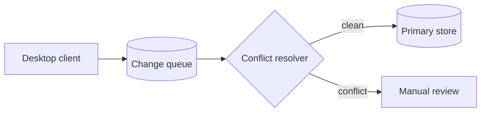

# Atlas 2.0 Launch Plan

Everything the team needs to ship Atlas 2.0 on **December 1**: scope, owners, risks, and the path from beta to general availability.

| Key | Value |
|---|---|
| Owner | Priya Raman |
| Status | On track |
| Target date | 2026-12-01 |


Scope is frozen as of **October 20**. New requests go to the 2.1 backlog.


## Goals

- Cut cold-start time from 2.4s to under **800ms**
- Ship offline sync to every paid workspace
- Reach 99.95% API availability for 30 days before GA

## Workstreams





## Timeline

{% timeline title="Milestones" events=[{date:"2026-09-15",title:"Private beta",status:"done",detail:"40 design partners"},{date:"2026-10-20",title:"Scope freeze",status:"done"},{date:"2026-11-10",title:"Public beta",status:"active",detail:"Feature flags on for 20% of workspaces"},{date:"2026-12-01",title:"General availability",status:"planned"},{date:"2027-01-15",title:"2.1 release",status:"planned"}] /%}

## Architecture



```bash
atlas migrate --workspace acme --dry-run
atlas migrate --workspace acme --apply
```

## Beta metrics



| Risk | Impact | Owner | Mitigation |
|---|---|---|---|
| Sync data loss | High | Marco | Write-ahead log + nightly restore drill |
| Migration timeouts | Medium | Lena | Batch by workspace size |
| Pricing confusion | Low | Priya | Comparison table on pricing page |

## Decisions

{% decision title="Use CRDTs for offline sync" status="accepted" date="2026-08-04" context="Last-write-wins lost edits in 3% of beta sessions." decision="Adopt CRDT-based merge for documents and comments." consequences="Larger payloads (~15%), but no silent data loss." /%}

## Launch checklist

- [ ] Security review signed off
- [ ] Load test at 5x expected traffic
- [ ] Support playbook published
- [ ] Press kit and launch post ready
