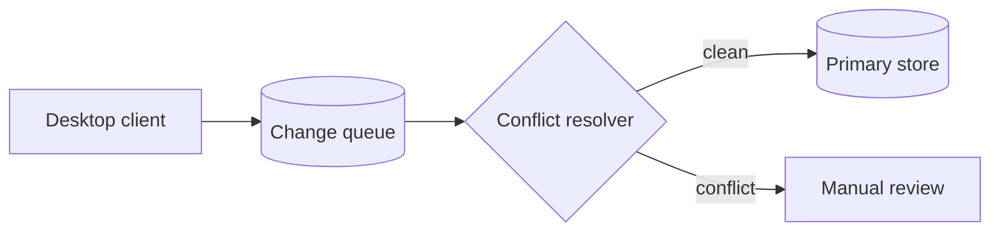

# Atlas 2.0 Launch Plan

Everything the team needs to ship Atlas 2.0 on **December 1**: scope, owners, risks, and the path from beta to general availability.

| Key | Value |
|---|---|
| Owner | Priya Raman |
| Status | On track |
| Target date | 2026-12-01 |

> [!NOTE]
> Scope is frozen as of **October 20**. New requests go to the 2.1 backlog.

## Goals

- Cut cold-start time from 2.4s to under **800ms**
- Ship offline sync to every paid workspace
- Reach 99.95% API availability for 30 days before GA

## Workstreams

**Workstream progress** (61% overall)

| Workstream | Progress |
|---|---|
| Sync engine | 82% |
| Desktop app | 64% |
| Migration tooling | 7 / 12 |
| Docs & onboarding | 40% |

**Launch board**

| Todo | In progress | Review | Done |
|---|---|---|---|
| Pricing page copy | Offline conflict resolver | SSO for enterprise | Load test at 5x traffic |
| Status page alerts | Migration dry run | | |

## Timeline

- **2026-09-15 · Private beta** (done) — 40 design partners
- **2026-10-20 · Scope freeze** (done)
- **2026-11-10 · Public beta** (in progress) — Feature flags on for 20% of workspaces
- **2026-12-01 · General availability** (planned)
- **2027-01-15 · 2.1 release** (planned)

## Architecture



```bash
atlas migrate --workspace acme --dry-run
atlas migrate --workspace acme --apply
```

## Beta metrics

**Weekly active workspaces:** W1 120 · W2 210 · W3 340 · W4 480

| Risk | Impact | Owner | Mitigation |
|---|---|---|---|
| Sync data loss | High | Marco | Write-ahead log + nightly restore drill |
| Migration timeouts | Medium | Lena | Batch by workspace size |
| Pricing confusion | Low | Priya | Comparison table on pricing page |

## Decisions

**Use CRDTs for offline sync** — Accepted, 2026-08-04

- **Context:** Last-write-wins lost edits in 3% of beta sessions.
- **Decision:** Adopt CRDT-based merge for documents and comments.
- **Consequences:** Larger payloads (~15%), but no silent data loss.

## Launch checklist

- [x] Security review signed off
- [x] Load test at 5x expected traffic
- [ ] Support playbook published
- [ ] Press kit and launch post ready
